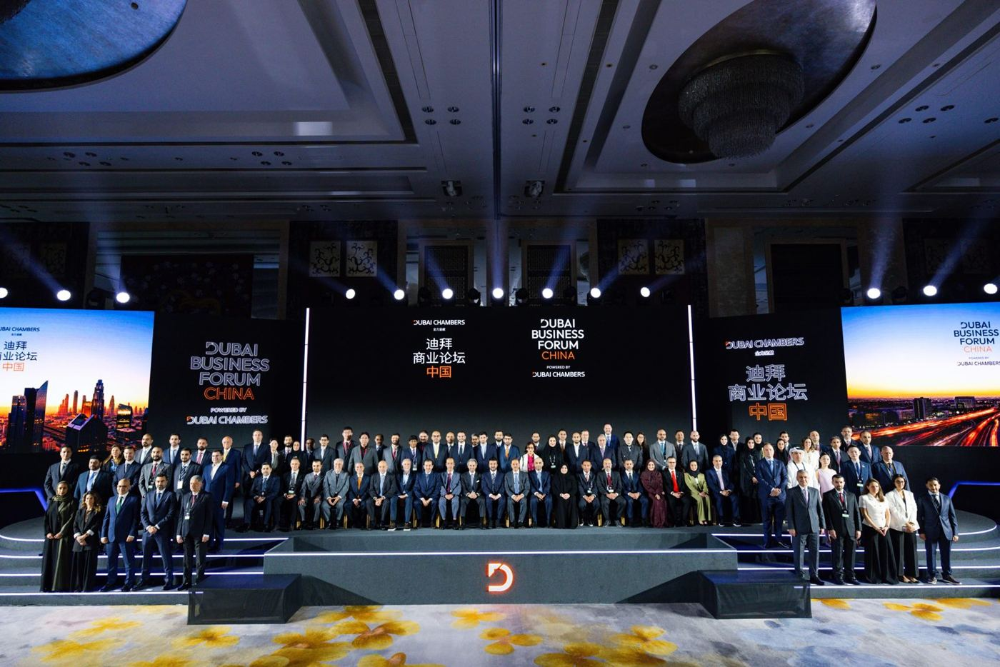
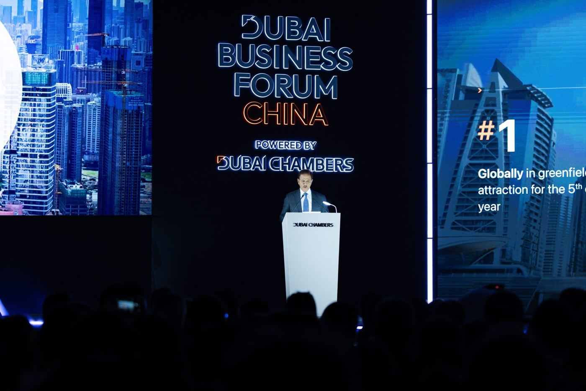
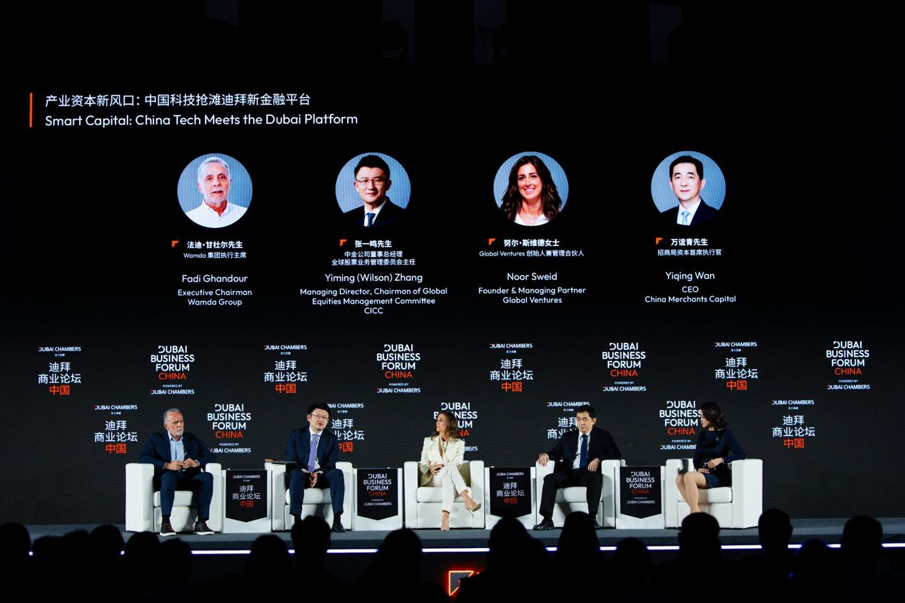
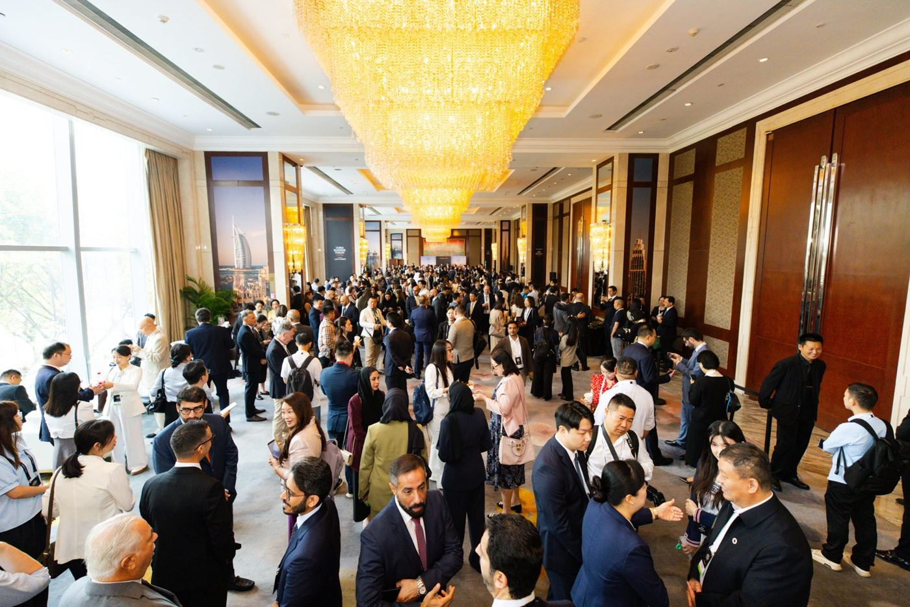

# MWE Display Joins Dubai Business Forum – China in Shenzhen to Advance Middle East Digital Signage Partnerships

*Marvel Tech Group CEO Celia Liang and Overseas Business Manager Bonnie Hu represented the company as Dubai Chambers brought its largest-ever overseas delegation to Shenzhen.*

*Dubai Chambers delegation at the Dubai Business Forum – China, Shangri-La Futian, Shenzhen, October 14, 2026. Photo: Dubai Media Office / Dubai Chambers*

**SHENZHEN, China** — MWE (Marvel Technology (China) Co., Ltd.), the commercial display brand and hardware manufacturer of Marvel Tech Group Co., Ltd., took part in the **Dubai Business Forum – China** on October 14, 2026, at the Shangri-La Hotel, Futian, Shenzhen. Marvel Tech Group Founder & CEO Celia Liang and Overseas Business Manager Bonnie Hu represented the company at the invitation-only forum, organized by Dubai Chambers to connect Chinese enterprises with Dubai's business ecosystem and to turn China–UAE business ambitions into practical growth.

For MWE, the Shenzhen Dubai Business Forum was a timely opportunity to meet decision-makers from Dubai's public and private sectors and to deepen the company's long-term focus on the Middle East market, where commercial display and digital signage projects must perform in high temperatures and direct sunlight.

## A record Dubai delegation for China–UAE business

The forum drew 854 Chinese investors and business leaders. Dubai Chambers led a delegation of 112 senior representatives from Dubai's public and private sectors — the largest delegation it has ever led to an event outside Dubai. Held under the theme "Momentum at Scale: Accelerating Shared Success," the program featured 22 expert speakers across 15 sessions on artificial intelligence, advanced manufacturing, logistics, smart mobility, the digital economy and venture capital. The Shenzhen Chamber of International Commerce and the China Chamber of International Commerce Guangzhou Chamber of Commerce served as supporting partners.

*H.E. Eng. Sultan bin Saeed Al Mansoori, Chairman of Dubai Chambers, opens the forum. Photo: Dubai Media Office / Dubai Chambers*

In his opening address, H.E. Eng. Sultan bin Saeed Al Mansoori, Chairman of Dubai Chambers, said: "China now ranks as Dubai's largest trading partner globally." According to Dubai Chambers, non-oil trade between Dubai and China rose from AED166.4 billion in 2016 to around AED363.5 billion in 2025, and the number of Chinese companies registered as active members of Dubai Chamber of Commerce reached 6,650 by the end of September 2026.

The forum also highlighted the opportunities created by the Dubai Economic Agenda D33, Dubai's role as a commercial, logistics and financial hub, and its growing position as a real-world testbed for city-wide AI applications. H.E. Mohammad Ali Rashed Lootah, President and CEO of Dubai Chambers, discussed the Chambers' Agentic AI transformation programme for Dubai's private sector during a fireside chat.

## Why the Middle East market matters for commercial displays

The topics on the agenda — smart cities, connected infrastructure, logistics corridors and digital trade — map directly onto the places where digital signage works hardest: retail and shopping malls, transport hubs, hospitality venues and outdoor public spaces across Dubai, the UAE and the wider GCC. In these environments, a commercial display has to stay readable in direct sunlight, run reliably through high summer temperatures and remain manageable by operators who may oversee screens across several cities.

*A panel session on Chinese technology and the Dubai platform. Photo: Dubai Media Office / Dubai Chambers*

MWE builds its outdoor LCD range for exactly these conditions. Its outdoor optically bonded displays use an industry-first active air circulation channel to suppress the rear-surface temperature of the liquid crystal glass and delay high-temperature degradation, while patented optical bonding removes the air gap that can cause condensation and improves sunlight readability. The company's RDM/OMC remote device management platform, deployed globally since 2018, integrates 9 physical sensors to monitor operating status, issue automatic anomaly alerts and support remote fault diagnosis, with real-time brightness compensation that keeps committed brightness levels across the deployment cycle. In a June 2026 interview with Digital Signage Today, Celia Liang described the goal as "an operational system capable of withstanding the high temperatures of the Middle East, the cold of Northern Europe and the rainy seasons of Southeast Asia."

## Building on an established GCC presence

The forum builds on groundwork MWE has already laid in the region. The company operates a local warehouse and service node in Saudi Arabia that supports project delivery, spare parts supply and high-temperature maintenance response across Saudi Arabia and the Gulf, backed by 24/7 multilingual remote technical support. Globally, MWE products have reached more than 150 countries and regions, and based on MWE internal platform statistics, RDM/OMC supports approximately 50,000 outdoor LCD devices while the CMS platform connects approximately 75,000 devices.

*Delegates network between sessions in Shenzhen. Photo: Dubai Media Office / Dubai Chambers*

Celia Liang and Bonnie Hu attended the forum to understand the Middle East market first-hand and to get closer to the needs of local customers in Dubai, the UAE and the wider GCC. Building on its existing overseas warehouse and service and support center in the region, MWE is now exploring the setup of a representative office in the Middle East to serve the market more closely. Dubai's connectivity to the Middle East, Africa and South Asia complements this footprint and the company's work with system integrators, DOOH operators and retail and hospitality project teams.

## Looking ahead in Dubai and the UAE

MWE will continue to develop partnerships in Dubai, the UAE and the GCC around 2,500–5,000-nit outdoor digital totems and information kiosks, indoor LCD video walls and digital posters, LED poster displays and connected display operations through CMS and RDM/OMC. Partners planning digital signage projects in the Middle East market are welcome to contact the MWE team through its official channels. MWE has also announced plans to exhibit at ISE 2027 in Barcelona, February 2–5, 2027, at Booth 4F350.

### About MWE

MWE (Make Win Easy) is operated by Marvel Technology (China) Co., Ltd., a Marvel Tech Group company. MWE is a global commercial display solution expert and industrial-grade hardware manufacturer, with team industry experience dating back to 2008. It serves DOOH, smart city infrastructure, and retail and system integration markets with an end-to-end service system spanning high-reliability commercial display hardware, cloud-based content management (CMS), and remote device operation and maintenance (RDM/OMC). An ISO 9001–certified manufacturer with more than 30,000 square meters of production facilities and 250+ patents, including 83 overseas patents, MWE has deployed commercial display products in 150+ countries and regions, supported by warehouse and service networks in Europe, the UK, North America, Japan, Australia and the Middle East. Official brand information: [news.marveltechgroup.com](https://news.marveltechgroup.com/).

Learn more about MWE commercial displays at [mwedisplay.com](https://www.mwedisplay.com/).
